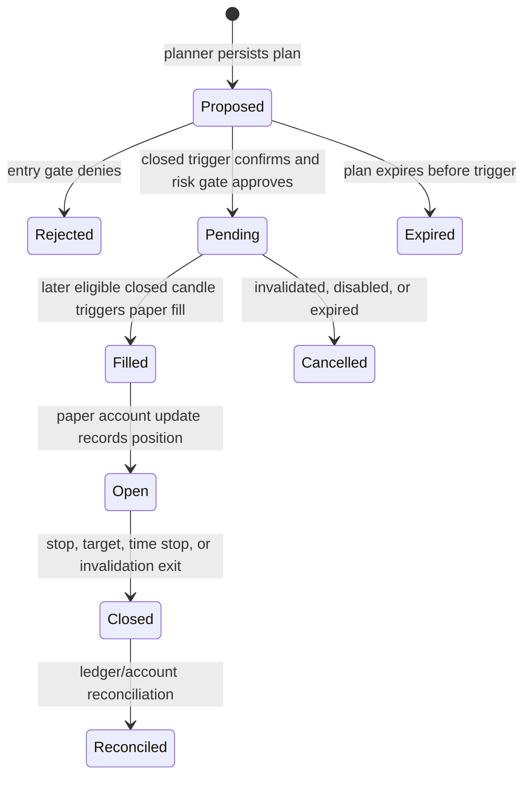

# Paper trading state machine

This describes the intended server-side path implemented in `backend/src/trader/executor.ts`, `backend/src/services/paperTradingService.ts`, and the position manager. Integration against a real disposable database has not been verified; this is not a claim that all transitions were exercised end to end.

## Transition rules

- A plan is analysis output, not an order. The stored-plan executor rechecks authorization and risk from server-loaded account state.
- Confirmed entries use closed trigger candles. The candle that creates a pending order cannot also fill it; a later eligible candle is required.
- On a later candle, risk and reward/risk are checked again at the modeled execution price, including a gap open. Position size includes configured entry and stop-exit fees and slippage.
- Failed checks produce a rejection/no-trade outcome. Stale or incomplete marks and unavailable required market data must block the action.
- Fills and exits are deterministic OHLC paper assumptions with configured fees and adverse slippage. Ambiguous stop/target touches prioritize the protective stop; gaps use the bar open where the simulator specifies.
- Position management continues for open positions when new entries are disabled, provided required fresh management bars are available. Missing management data prevents a trustworthy advance and requires operator attention.

## Idempotency, retries and recovery

The application uses processed-candle checkpoints, account versions and event keys as described by the service and SQL migrations. These mechanisms have unit/source coverage, but two-session races, crash recovery, and duplicate delivery against PostgreSQL remain unverified. Do not assume process-local scheduler serialization protects multiple worker instances. Deploy one scheduler at most until a durable lease and recovery path are tested.

## Evidence still required

Run an integration test against disposable Supabase from persisted candle through plan, risk decision, pending order, later-bar fill, position close, account update and reconciled ledger. Repeat delivery and restart between each persisted transition. Assert no duplicate order, fill, position mutation, or ledger event. No manual BUY/SELL workflow or brokerage execution is part of this state machine.
